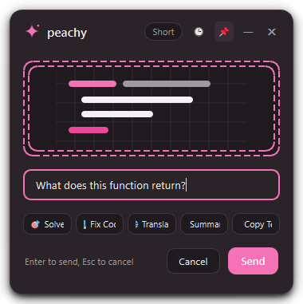
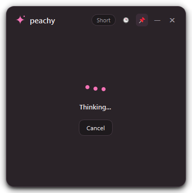
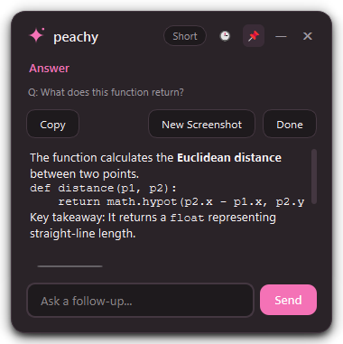

# 🍑 Peachy — The Cute Desktop Screen Assistant

> **A fast, polite, and aesthetic Windows screen assistant powered by Google Gemini multimodal AI.**
> Select any text, code, equation, chart, or multiple-choice question on any screen, and get an instant, clear answer without ever losing focus on your work.

---

## ✨ Visual Showcase

| Ask View | Thinking View | Answer View | Minimized Pill |
| :---: | :---: | :---: | :---: |
|  |  |  |  |

---

## 🌟 Why Peachy?

- **Polite Window Behavior**: Peachy never steals typing focus or blocks your other windows. When an answer arrives, you keep typing uninterrupted in Chrome, VS Code, or Word.
- **Pixel-Exact Multi-Monitor Capture**: Flawlessly supports multi-monitor rigs with mixed scaling (100%, 125%, 150%, 200% DPR) and negative desktop coordinates.
- **Aesthetic Visual Identity**: Designed with a 16px soft-radius card, delicate `#F472B6` pink accents, custom drop shadows, fluid animations, and a cute 4-point sparkle mascot.
- **Multi-Turn Context & Follow-Ups**: Ask questions about your screenshot, ask follow-ups, or click **"New Screenshot"** to continue the conversation with an updated screen area.
- **Secure Key Storage**: API keys are stored strictly in the **Windows Credential Manager** via OS vault encryption, never saved in plaintext files or logs.
- **Strict Privacy**: Peachy only looks at your screen when you explicitly trigger the shortcut. It sends only the region you box, and only when you click Send. Nothing is recorded, uploaded in the background, or permanently stored.

---

## 🚀 Quick Start

### 1. Download & Launch
- Download the latest standalone release folder from GitHub Releases.
- Extract anywhere and run `Peachy.exe`. Peachy will appear gracefully in your Windows system tray.

### 2. Get a Free Gemini API Key
1. Visit [Google AI Studio](https://aistudio.google.com/).
2. Sign in with your Google account and click **Get API Key** -> **Create API Key**.
3. Right-click Peachy's sparkle icon in the Windows taskbar tray, select **Settings**, paste your key, and click **Test**.
4. Once verified (green checkmark), click **Save Settings**.

### 3. Usage & Shortcuts
- **Capture & Ask**: Press `Ctrl+Shift+Space` (default) to freeze the screen. Drag a box around what you want to understand, type your prompt (or leave blank to explain automatically), and press `Enter`.
- **Copy Response**: Click **Copy** to instantly place the answer onto your clipboard (shows `"Copied!"` confirmation).
- **Follow-up**: Type in the rounded bottom pill and press `Enter`.
- **New Screenshot**: Click `"New Screenshot"` to snap another area while retaining your active conversation context.
- **Pin / Unpin**: Click the pin icon (`📌`) in the header to toggle whether Peachy floats on top or recedes behind other windows when you click outside.
- **Minimize to Pill**: Click the minimize button (`—`) to collapse Peachy into a small floating pink pill (`✨ peachy`); click the pill anytime to expand it back.
- **Dismiss**: Press `Esc` or click the close icon (`✕`) to clear the conversation and return to idle.

---

## ⚙️ Configuration & Settings

Open Settings anytime from the system tray menu:
- **Global Shortcut**: Click the recorder button and press any combination (e.g. `Alt+Q`). Peachy validates and registers it live with zero application restarts needed.
- **Double-Tap 'C'**: Optional shortcut mode. Enable the toggle and adjust the detection window (200–500 ms, default 280 ms).
- **Model Selection**: Switch between `gemini-3.5-flash`, `gemini-3.8-flash`, or custom models with text fallback.
- **Popup Preferences**: Choose default pinned state and initial popup placement (*"Near selection"* vs *"Last used spot"*).
- **Windows Startup**: Check *"Launch Peachy at Windows startup"* to register Peachy in Windows user run registry (`HKCU\Software\Microsoft\Windows\CurrentVersion\Run`).

---

## 🔒 Privacy & Security

Peachy was built from the ground up for strict privacy:
1. **Zero Background Surveillance**: The screen is only captured upon explicit hotkey or tray activation.
2. **Selective Upload**: Only the cropped pixel area you select is transmitted over encrypted HTTPS to Google Gemini.
3. **No Key Leaks**: Credentials are kept in the Windows Credential Manager vault and redacted from all log streams (`%LOCALAPPDATA%\Peachy\logs\peachy.log`).
4. **Zero Persistent Storage**: Screenshots and conversation histories are held purely in volatile RAM and freed immediately when you close the popup.

---

## 🛠️ Troubleshooting & FAQ

### Shortcut doesn't trigger or shows a conflict
- Another application (e.g., Discord, PowerToys, or OBS) may already hold the global shortcut.
- Open Peachy Settings and record an alternative shortcut like `Alt+Q` or `Ctrl+Alt+Space`.

### Keystrokes or Double-tap C not working in Administrator windows
- Under Windows **User Interface Privilege Isolation (UIPI)**, non-elevated user apps cannot intercept input in elevated (Run as Administrator) windows.
- If you frequently work inside Administrator terminal windows, launch `Peachy.exe` as Administrator.

### Video / DRM media appears black in screenshot
- Commercial video players (Netflix, Disney+, protected browser video) utilize hardware-protected DRM overlays that block screen capture APIs by Windows OS security policy.

### Windows SmartScreen warning on launch
- Because Peachy is an open-source, unsigned executable, Windows SmartScreen may show a *"Windows protected your PC"* blue dialog on first run.
- Click **More info** -> **Run anyway**.

### Why is the build `onedir` instead of `onefile`?
- `onedir` mode ensures instant sub-second startup without the multi-second decompression overhead of `onefile`.
- Avoids false positive heuristic alarms triggered when onefile executables unpack temporary executable libraries into `%TEMP%`.

### Where are application logs stored?
- Logs with automatic rotation and key redaction are stored at:
  `%LOCALAPPDATA%\Peachy\logs\peachy.log`

---

## 🏗️ Building from Source

### Prerequisites
- Windows 10 or 11 (64-bit)
- Python 3.12+ (or 3.13)
- PowerShell 5.1+

### Build Steps
1. Clone the repository:
   ```powershell
   git clone https://github.com/crys1ss/peachy.git
   cd peachy
   ```
2. Run the automated PowerShell build script:
   ```powershell
   .\build.ps1
   ```
   *The script creates a clean build venv, installs dependencies, verifies the full automated pytest suite, generates multi-size icons, and compiles Peachy into `dist\Peachy\Peachy.exe`.*

---

## 📄 License
MIT License. Free and open source for everyone.
