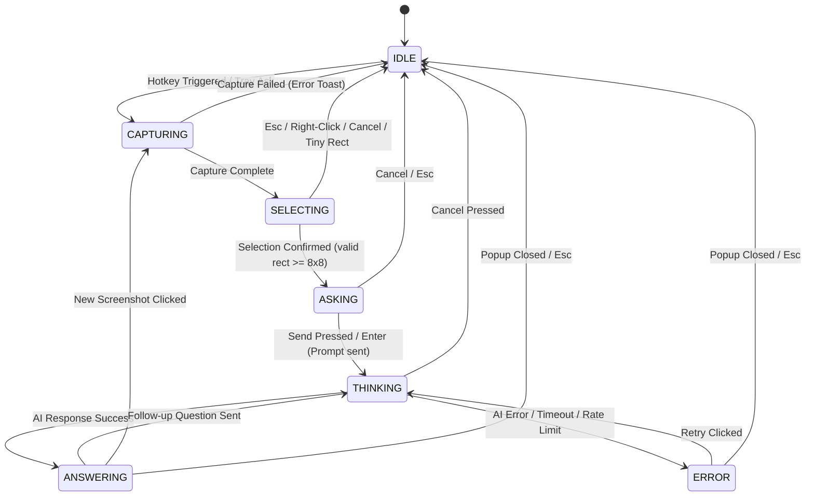

# Peachy Architecture & Design Specification

## 1. System Overview
Peachy is a lightweight, high-performance Windows desktop screen assistant built with Python 3.12/3.13 and PySide6 (Qt 6). It lives in the system tray, listens for a global hotkey (`Ctrl+Shift+Space` by default), provides pixel-accurate screen cropping, and queries Gemini vision models with zero clutter, zero telemetry, and complete privacy.

---

## 2. Architecture & Module Decomposition

```
peachy/
├── app.py                      # Application entry point, single-instance guard, logging setup
├── config/
│   ├── __init__.py
│   └── settings.py             # Dataclass settings, atomic JSON persistence, safe recovery
├── core/
│   ├── __init__.py
│   ├── win32.py                # Win32 ctypes wrappers with argtypes/restype/error checking
│   ├── hotkey_manager.py       # Global hotkey registration via RegisterHotKey & native event filter
│   ├── state_manager.py        # Explicit finite state machine (FSM) preventing duplicate activations
│   ├── app_controller.py       # (Day 3) Coordinator between hotkey, overlay, popup, and AI provider
│   ├── worker.py               # (Day 3) QThread worker for async non-blocking AI execution
│   └── double_tap.py           # (Day 5) Low-level keyboard hook (WH_KEYBOARD_LL) for optional double-tap C
├── capture/                    # (Day 2)
│   ├── __init__.py
│   ├── geometry.py             # Pure math: rect normalization, multi-monitor clamping, DPR scaling
│   ├── screen_capture.py       # Per-monitor screen capture & foreground HWND tracking
│   └── selection_overlay.py    # Per-monitor fullscreen transparent overlays for click-drag crop
├── ai/                         # (Day 3)
│   ├── __init__.py
│   ├── provider.py             # Abstract AI provider interface and typed friendly error hierarchy
│   └── gemini_provider.py      # google-genai SDK implementation with token/image optimization
├── ui/
│   ├── __init__.py
│   ├── tray_manager.py         # QSystemTrayIcon with custom painted sparkle icon and context menu
│   ├── theme.py                # (Day 4) Color tokens (#F472B6 accent, #FFF1F6 surface), fonts, styling
│   ├── peachy_popup.py         # (Day 3-4) Single popup window hosting Ask/Thinking/Answer/Error views
│   └── settings_window.py      # (Day 5) Visual settings editor (shortcut recorder, API key, options)
├── resources/                  # Icons, SVG assets
└── tests/                      # Automated unit and integration test suite (pytest + pytest-qt)
```

---

## 3. Finite State Machine (FSM)

The application flow is governed by `StateManager`, an explicit finite state machine with 7 discrete states.



### State Definitions & Transitions Table

| Current State | Event / Trigger | Next State | Entry Action | Exit Action | Invariant / Guard |
| :--- | :--- | :--- | :--- | :--- | :--- |
| **IDLE** | `hotkey_triggered` or `tray_ask` | **CAPTURING** | Save foreground window HWND. | None. | **Only transition allowed out of IDLE.** Any subsequent hotkey press while not in IDLE is ignored. |
| **CAPTURING** | `capture_complete` | **SELECTING** | Launch per-monitor selection overlay; grab mouse/keyboard focus. | None. | All screens captured; screen images cached in memory. |
| **CAPTURING** | `capture_failed` | **IDLE** | Log error; display friendly toast notification. | Restore foreground HWND. | Capture exception or unhandled display switch. |
| **SELECTING** | `selection_confirmed` | **ASKING** | Calculate crop from normalized rect; show Peachy popup in **Ask view**. | Close all overlays; release input grabs. | Rect width $\ge 8$ and height $\ge 8$ physical pixels. |
| **SELECTING** | `selection_cancelled` | **IDLE** | Close all overlays; release input grabs. | Restore foreground HWND. | Esc pressed, right-click, backspace, or rect $< 8\times 8$. |
| **ASKING** | `submit_question` | **THINKING** | Switch popup to **Thinking view** (bouncing dots animation); dispatch worker. | Disable Send button. | Question string or empty (auto-explain). |
| **ASKING** | `popup_closed` | **IDLE** | Hide popup; free crop image buffer. | Restore foreground HWND. | User pressed Esc or Cancel button. |
| **THINKING** | `response_received` | **ANSWERING** | Render markdown response in **Answer view**; stop thinking animation. | None. | Response ID matches current active request ID. |
| **THINKING** | `request_failed` | **ERROR** | Switch popup to **Error view** showing friendly message and Retry button. | None. | Typed AI provider error (Network, Timeout, RateLimited, etc.). |
| **THINKING** | `request_cancelled` | **IDLE** | Mark current request ID obsolete; hide popup; free memory. | Stop worker thread. | Cancel button clicked. Late responses will be discarded. |
| **ANSWERING** | `submit_followup` | **THINKING** | Append to chat history; switch to Thinking view; dispatch worker. | None. | Image is retained in context without re-uploading. |
| **ANSWERING** | `new_screenshot` | **CAPTURING** | Hide popup; retain current conversation history; re-trigger capture. | None. | Enables multi-screenshot conversational flow. |
| **ANSWERING** | `popup_closed` | **IDLE** | Hide popup; clear conversation history; free all image buffers. | None. | Popup closed or Esc. |
| **ERROR** | `retry_clicked` | **THINKING** | Re-dispatch previous question with existing crop and history. | None. | Worker restarted with new request ID. |
| **ERROR** | `popup_closed` | **IDLE** | Hide popup; clear session state. | None. | Closed without retry. |

---

## 4. Single Popup Window Architecture

### Design Decision
Rather than spawning separate dialogs for question prompt and markdown answer, Peachy utilizes **ONE persistent `PeachyPopup` window** that hosts a `QStackedWidget` containing four view states:
1. `AskView`: Thumbnail preview, question text input (auto-focused), Send and Cancel buttons.
2. `ThinkingView`: Mascot animation, status text, and Cancel button.
3. `AnswerView`: Markdown text browser, Copy button, follow-up input bar, New Screenshot button, Close button.
4. `ErrorView`: Friendly human-readable explanation, error code, Retry and Close buttons.

### Benefits
- **Zero Focus Handoff Glitches**: Separate windows cause Windows OS focus-stealing conflicts and flashing taskbar buttons. A single window switches views seamlessly in-process.
- **Minimal Latency**: Views are pre-instantiated in the stack; switching is instantaneous without window creation overhead.
- **Predictable Geometry**: Window positioning relative to the selected screen crop is calculated once and preserved smoothly throughout the session.

---

## 5. Threading Model & Concurrency

1. **Main UI Thread**:
   - Manages the `QApplication` event loop.
   - Hosts `QSystemTrayIcon` and native Windows event filter (`WM_HOTKEY`).
   - Renders selection overlays and the `PeachyPopup` widget.
   - Evaluates all `StateManager` state transitions.

2. **Async Worker Thread (`QThread` / `QThreadPool`)**:
   - Performs all slow I/O, network requests, and Gemini Vision API operations.
   - Communicates strictly via Qt signals (`finished`, `error`, `progress`). The worker never holds or manipulates UI widget references.

3. **Stale Response Protection (Request IDs)**:
   - Every request is tagged with an incremental integer `request_id`.
   - If the user cancels or starts a new capture while a request is in flight, `current_request_id` is incremented.
   - When a background thread delivers a payload, `app_controller` compares the payload's ID against `current_request_id`. Stale replies are silently dropped.

---

## 6. Windows OS Limitations & Mitigation Strategies

### A. UIPI (User Interface Privilege Isolation) & Admin Windows
- **Limitation**: Under Windows UIPI, an application running at standard user integrity cannot intercept keystrokes, receive hooks, or register hotkeys that override elevated (Administrator) windows.
- **Mitigation**:
  - Catch `RegisterHotKey` Win32 errors cleanly (e.g. `ERROR_HOTKEY_ALREADY_REGISTERED` = 1409).
  - Never crash if an elevated window holds the foreground.
  - Document clearly in README that to interact over Admin consoles (e.g. elevated PowerShell), Peachy must also be launched as Administrator.

### B. Windows Foreground Lock Rules
- **Limitation**: Windows actively restricts background processes from arbitrarily calling `SetForegroundWindow` to steal user focus.
- **Mitigation**:
  - Receiving a registered `WM_HOTKEY` automatically grants foreground rights to the receiving process on Windows.
  - Peachy leverages this granted right immediately upon hotkey activation to bring the selection overlay to the front.
  - For the **Answer view**, Peachy sets `Qt.WindowDoesNotAcceptFocus` / `WA_ShowWithoutActivating` so the user's active editor/browser never loses typing focus while reading the answer.

### C. Mixed DPI & Multi-Monitor Geometry
- **Limitation**: Multiple monitors often possess differing scale factors (e.g., 100%, 125%, 150%, 200%) and negative coordinate offsets (e.g., secondary monitor positioned to the left of or above the primary display). A single giant virtual desktop window results in blurriness and coordinate distortion.
- **Mitigation**:
  - Query each physical monitor individually via `QGuiApplication.screens()`.
  - Instantiate **one frameless fullscreen overlay window per monitor**.
  - Capture and render using physical pixels mapped precisely via each screen's `devicePixelRatio()`.

### D. DRM Content & Hardware Overlays
- **Limitation**: Encrypted video streams (Netflix, Spotify, protected browser playback) utilize hardware overlays or protected media paths (PMP). Desktop duplication and BitBlt return black frames for these surfaces.
- **Mitigation**:
  - Detect empty / black crops.
  - Present a friendly explanation ("This window is protected by DRM media policies and cannot be captured") instead of an unhandled crash or erroneous AI hallucination.

---

## 7. Pinned Dependencies & Documentation Citations

| Package | Pinned Version | Official Documentation Citation |
| :--- | :--- | :--- |
| **PySide6** | `6.8.2.1` | [Qt for Python 6.8 LTS Official Documentation](https://doc.qt.io/qtforpython-6/) |
| **pytest** | `9.1.1` | [Pytest Official Documentation](https://docs.pytest.org/en/stable/) |
| **pytest-qt** | `4.5.0` | [pytest-qt Official Documentation](https://pytest-qt.readthedocs.io/en/latest/) |
| **mss** | `10.0.0` | [Python mss Documentation](https://python-mss.readthedocs.io/) |
| **Pillow** | `12.3.0` | [Pillow Official Documentation](https://pillow.readthedocs.io/) |
| **google-genai** | `2.32.0` | [Google GenAI Python SDK Documentation](https://googleapis.github.io/python-genai/) |
| **keyring** | `25.7.0` | [Keyring Official Documentation](https://keyring.readthedocs.io/) |
| **PyInstaller** | `6.22.3` | [PyInstaller Official Documentation](https://pyinstaller.org/) |
